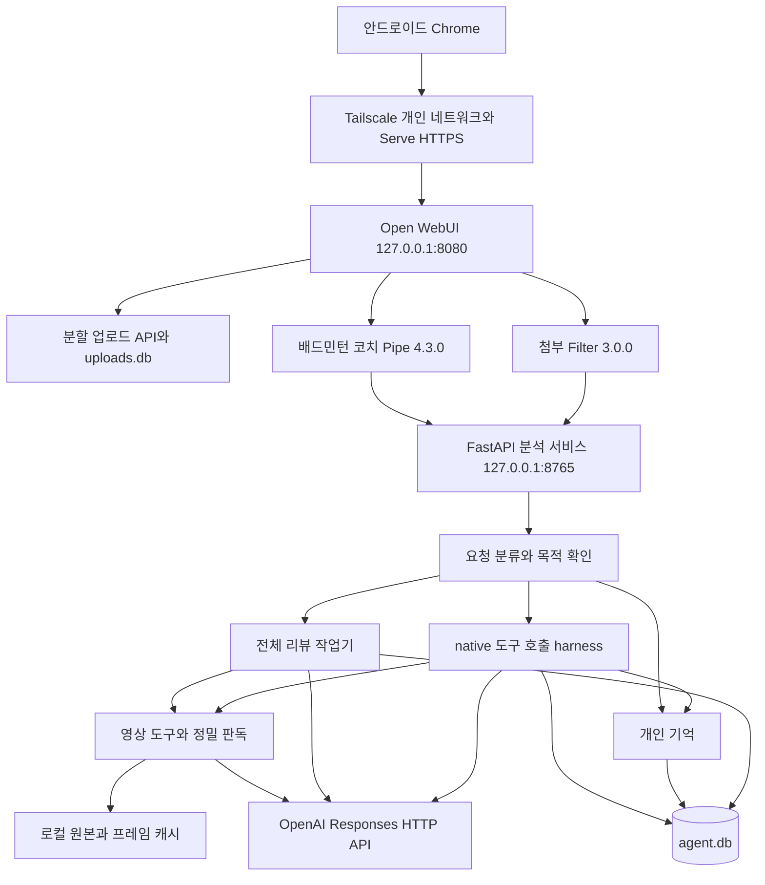
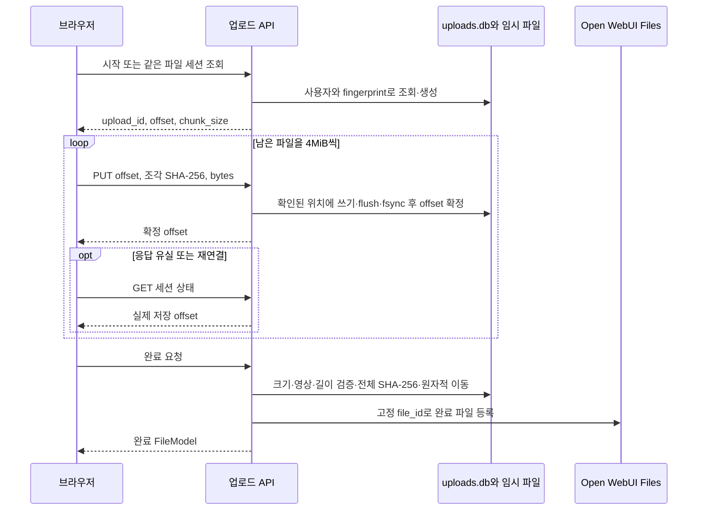
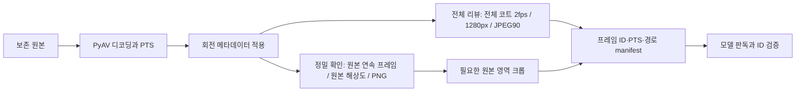
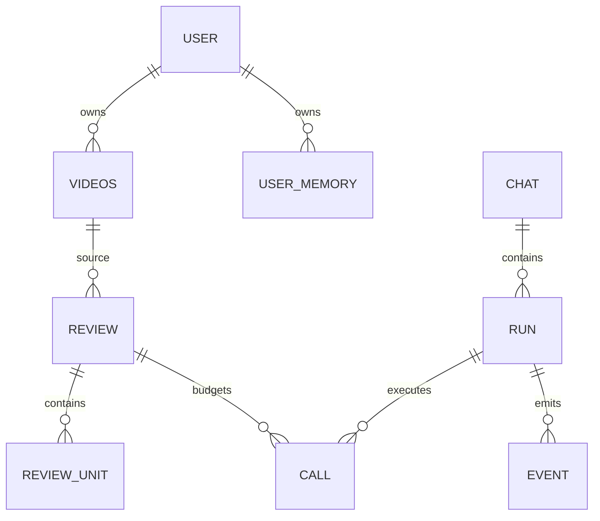
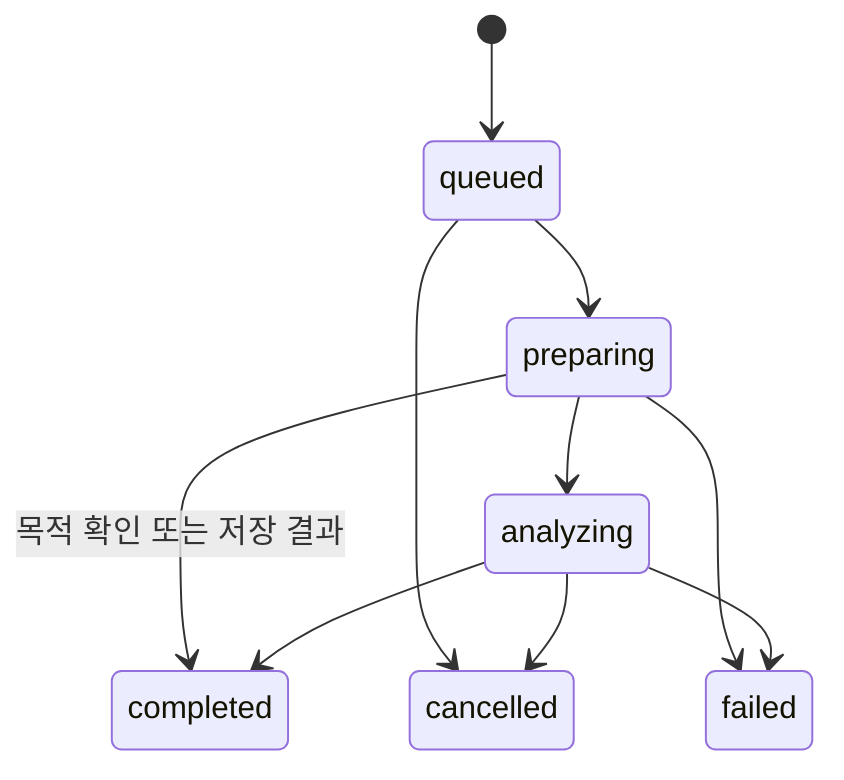

# 배드민턴 영상 코치 상세 설계서

문서 기준: 2026-11-16. 저장소의 현재 구현을 설명하며 제품 보장이나 향후 계획과 구분합니다.
사용 절차는 [사용 설명서](USER_GUIDE.md), 과거 시험 결과와 잔여 한계는 [검증 기록](../VALIDATION.md)을 참고하세요.

## 1. 목적과 구현 범위

안드로이드 Chrome에서 촬영 영상을 업로드하고, 개인 선수의 경기 운영·자세·기술을 근거 시각이 있는 리포트와 후속 대화로 설명한다. 영상 원본은 Windows PC에 보관하고, 모델에는 필요한 이미지와 텍스트를 전송한다.

핵심 요구는 다음과 같다.

- 일반 지식, 기존 설명, 특정 장면 확인, 전체 리뷰를 구분한다.
- 경기 리뷰는 전체 특징·수준 추정·잘한 점·아쉬운 점·개선 계획을 제공한다.
- 강습·난타에는 각각의 목적에 맞는 수행·반복 안정성 기준을 사용한다.
- 단순 요약 프롬프트만 실행하는 구조를 넘어서 실제 도구 호출·관찰 저장·재사용을 수행한다.
- 브라우저 연결과 독립적으로 작업을 보존하고, 비용을 예약·정산한다.
- 같은 계정의 새 채팅에서는 개인 기억을 참고하되 다른 채팅 영상 권한을 확대하지 않는다.
- 대용량 파일 전송 실패 시 확정된 저장 위치부터 이어 올린다.

기본 운영 대상은 Windows PC 1대·개인 사용자 1명·대체로 15분 이내 영상이다. 사용자·채팅 권한 검사는 구현하지만 다중 사용자 서비스 운영, 공개 SaaS, 실시간 경기 분석, 득실점 자동 집계, 정확한 속도·파워·악력 측정은 범위에 포함하지 않는다.

## 2. 배포 구성과 신뢰 경계



| 구성 | 접근·책임 |
|---|---|
| Tailscale Serve | 개인 네트워크의 HTTPS를 로컬 UI로 프록시. Funnel 공개 발행은 사용하지 않음 |
| Open WebUI | 로그인, 채팅, 첨부 선택, Pipe·Filter 실행, 답변·진행 상태 표시 |
| 업로드 API | Open WebUI의 검증된 사용자 인증. 파일 소유자는 해당 사용자로 고정 |
| 분석 서비스 | localhost 바인딩, 내부 Bearer 키, 사용자·채팅별 리소스 검사 |
| 모델 | 등록된 도구 이름·video_id·시간·정규화 영역만 요청. OS 전체 셸을 열어주지 않음 |
| 로컬 디스크 | 로그인·채팅·영상·보고서·비용·개인 기억의 영속 저장 |
| 외부 모델 API | 이미지·질문·관찰·선택된 기억을 처리. PC 원본 파일 경로를 도구 인자로 사용하지 않음 |

내부 API의 `user_id`, `chat_id`는 신뢰된 Open WebUI 연결 코드가 공급한다. 내부 키를 가진 호출자는 신뢰 영역에 속하므로 이 API를 휴대폰에 직접 노출하지 않는다. 내부 키는 독립 사용자 인증을 대신하는 비밀값이며, 누출 시 이 신뢰 경계가 깨진다.

## 3. 소스 구조와 책임

| 소스 | 책임 |
|---|---|
| `badminton/config.py` | 데이터 경로·허용 설정·비밀값 초기화·키 조회 |
| `badminton/bootstrap.py` | Open WebUI 환경·기본 모델·Pipe·Filter 설치와 가입 설정 |
| `badminton/operations.py` | 시작·준비 대기·중지·상태·바로가기·로그인 자동 실행·Tailscale 설정 |
| `badminton/webui.py`, `webui_upload.py` | UI 서버 진입점, 기존 작은 파일 업로드, 확장 업로드 등록 |
| `badminton/uploads.py`, `upload_client.js` | 인증된 분할 전송·이어 올리기·진단·브라우저 진행 표시 |
| `openwebui_video_filter.py` | 첨부 소유권 검사·영상 등록·현재 첨부 맥락 갱신 |
| `openwebui_coach_pipe.py` | 채팅 명령·작업 요청·SSE 소비·진행 이벤트·저장 결과 표시 |
| `badminton/service.py` | 내부 HTTP API·단일 워커 임대·분류·경량/무거운 작업 분리 |
| `badminton/store.py` | SQLite 스키마·작업·이벤트·관찰 캐시·복구 |
| `badminton/routing.py`, `intake.py` | 구조화된 의도 분류·현재 진술 추출·분석 목적과 선수 확인 |
| `badminton/agent.py` | Responses 공급자·허용 도구·도구 반복·근거·답변 완료 검증 |
| `badminton/video.py`, `vision.py`, `motion.py` | 메타데이터·원본 관리·PTS 프레임·이미지 입력·로컬 이동 후보 |
| `badminton/precision.py` | 원본 연속 이미지 판독·프레임 ID 검증·정밀 관찰 캐시 |
| `badminton/review.py`, `review_store.py` | 전체 시간대 판독·진행률·원자적 예산·재개·종합·귀속 검증 |
| `badminton/coaching.py`, `reporting.py` | 장면의 실행 가능한 코칭·연습 계획·목적별 다섯 항목 리포트 |
| `badminton/memory.py` | 사용자 프로필·분석 에피소드·연습 경과·검색·정정·삭제 |
| `badminton/pricing.py` | 모델별 요금 스냅샷·보수적 예약·실제 사용량 정산 |
| `badminton/hermes.py`, `mcp_server.py` | 선택적 Hermes API 어댑터와 동일 영상 도구의 stdio MCP 경로 |
| `tests/` | 합성 영상·모의 모델 중심 회귀 시험 |
| `scripts/` | 격리 시험·실제 API 시험·기존 캐시 발행/재검증 도구 |

## 4. 첨부 등록과 대용량 전송

### 4.1 두 저장 단계를 구분한다

1. **업로드 저장**: 휴대폰의 파일을 Open WebUI 업로드 폴더에 완성하고 `FileModel`로 등록한다.
2. **분석 등록**: Filter가 해당 FileModel의 사용자 소유권을 확인하고, 분석 서비스가 보존 원본을 복사한 뒤 `video_id`를 발급한다.

업로드 단계에서는 모델을 호출하지 않는다. 기존 영상의 재등록은 `(user_id, chat_id, source_id)` 고유 제약으로 중복을 막는다. 분석 등록은 `webui/uploads` 하위의 실제 파일만 허용하고 확장자·용량·실제 영상 스트림·길이·디스크 여유를 검사한다. 완료 원본은 `.partial`에 복사한 뒤 원자적으로 교체한다.

### 4.2 브라우저 업로더

기존 `/static/loader.js` 내용 뒤에 업로더를 붙여 원래 테마 로딩을 보존한다. 응답은 `Cache-Control: no-store`, `X-Badminton-Upload-Version: 2`를 가진다. Open WebUI 번들의 minified 코드를 직접 수정하지 않는다.

업로더는 같은 출처의 `POST /api/v1/files[/]`, `FormData.file`, 크기 32MiB 이상인 요청을 가로채고, 최종적으로 원래 첨부 함수가 기대하는 `FileModel` JSON 응답을 반환한다. 작은 파일 경로는 유지한다. 이 연결점은 Open WebUI 0.13.3의 첨부 계약을 전제로 하므로 Open WebUI 업그레이드 시 재검증이 필요하다.



파일 식별 fingerprint는 파일명·크기·lastModified·처음/마지막 1MiB의 해시를 다시 SHA-256한 값이다. 전체 파일을 브라우저 메모리에 읽지 않는다. 이 식별자는 이어 올릴 파일을 구분하는 실용적 표식이며 전체 내용 해시를 대신하지 않는다. 매 조각은 별도 SHA-256을 확인하고 완료 원본 전체의 SHA-256을 서버에서 기록한다.

서버는 한 조각의 전체 수신이 끝난 뒤에만 파일과 offset을 갱신한다. 조각 중간 연결 종료는 offset을 전진시키지 않는다. 파일 쓰기·fsync 뒤 DB 확정을 수행하므로, 쓰기 후 프로세스가 종료되면 다음 조각에서 DB의 확정 위치로 잘라 재작성한다. 수락된 응답이 유실된 경우 상태 조회로 중복 저장을 막는다.

- 같은 세션의 쓰기·완료는 asyncio 잠금으로 직렬화한다. UI 서버는 단일 워커로 실행한다.
- 세션 조회와 조각 쓰기는 사용자 소유권을 검사한다. 다른 사용자 세션은 404로 처리한다.
- 브라우저는 파일별 순차 큐, 조각당 최대 5회 시도와 지연, 상태 재조회로 복구한다.
- 완료 file_id는 세션 생성 때 고정하여 재요청·등록 후 종료에도 중복 등록을 방지한다.
- 전체 전송 후 파일 이동만 끝난 상태에서 종료되면 완료 요청이 목적지 파일을 다시 검증할 수 있다.
- 미완료 세션은 마지막 확정 저장 후 24시간이 지난 뒤 서비스 시작 시 정리한다.
- 레거시 전체 multipart 요청에는 시작·수신 바이트·disconnect·종료 상태 로그를 추가한다. 기존 1MiB 복사는 네트워크 분할 전송이 아니었다.

## 5. 요청 구분과 분석 목적 확인

Pipe가 현재 사용자·채팅·메시지 ID를 얻고 내부 작업을 생성한다. 동일한 `(user_id, chat_id, request_id)`는 같은 작업이다. 첨부 묶음은 `chat_context`에 저장하며 일반 후속 질문은 현재 대상을 사용한다. 파일명이나 일부 촬영일 별칭으로 대상을 좁히는 연결도 있다.

분류기는 현재 질문·최근 이력·저장 리포트 여부·개인 기억·현재 영상의 선택 정보를 구조화된 JSON으로 읽는다.

| 최종 의도 | 경로 |
|---|---|
| general | 영상 없이 일반 설명·연습법·대화 |
| explanation | 기존 보고서·관찰 설명. 새 영상 도구 없이 처리 가능 |
| clip | 해당 동작·구간의 새 관찰과 정밀 확인 |
| match | 단일 영상 전체 리뷰. 초기 분류의 review를 내부 match로 정규화 |
| 확인 필요 | 유형·목적·선수 등 실제 부족한 내용을 묻고 완료 응답으로 대기 |

`scope=auto|match|clip`는 작업 입력의 선택 필드다. 일반 의도 분류 결과와 분석 프로필을 작업에 저장한다. 단어 하나·질문 길이만으로 “이전과 같은 정밀 질문”이라고 처리하지 않는다.

분석 프로필에는 `video_kind=match|lesson|rally|unknown`, `analysis_focus=gameplay|technique|both|unspecified`, 선택 동작, 선수 지정과 확인 대기 정보가 있다. 저장은 사용자·채팅·영상별이다. 현재 명시한 변경이 이전 선택보다 우선하며, 현재 질문에서 말하지 않은 프로필은 임의 추측하지 않는다.

전체 리뷰에서 선수 지정이나 목적이 빠지면 필요한 항목만 묻는다. 이미 말한 목적은 반복해서 묻지 않는다. 일반 그립 질문은 영상 미첨부를 이유로 차단하지 않는다. 같은 영상의 기존 리포트에 대한 “왜 그렇게 봤어?”는 저장 기록을 먼저 사용한다.

## 6. native harness와 허용 도구

현재 기본 harness는 `runtime=native`이다. `Provider`가 공식 Responses HTTP 인터페이스를 직접 사용하고 모델 출력의 function call을 실제 Python 도구로 실행한다. 도구 결과·관찰을 다음 요청에 넣어 추가 확인 또는 `complete_analysis`까지 반복한다. SDK가 설치되어 있어도 Windows에서 차단된 보조 모듈에 의존하지 않는 HTTP 경로를 사용한다.

| 도구 | 역할과 제약 |
|---|---|
| get_video_info | 허용 video_id의 길이·해상도·원본 FPS·회전·선수 지정 |
| get_overview | 약 10초 간격의 성긴 탐색 관찰. 정밀 근거나 전체 리뷰 완료를 대신하지 않음 |
| find_segments | 저장 개요의 텍스트 관련도로 후보 구간 검색 |
| inspect_segment | start/end/fps/box로 프레임 확인. fps=0은 원본 연속 |
| inspect_trajectory | 원본 연속 장면과 ROI 내 이동 후보를 대조 |
| crop_region | 정규화 box의 한 시점 원본 영역 확대 |
| get_analysis_history | 같은 채팅의 질문·선수 지정·관찰·저장 리포트 |
| get_user_memory | 같은 사용자의 선택된 장기 텍스트 기록 |
| reuse_observations | 같은 채팅·현재 영상에 속한 완료 작업의 실제 근거 ID 재사용 |
| set_player | 사용자가 명시한 옷·위치를 저장. 얼굴 인식 없음 |
| complete_analysis | general/context/analysis/clarification 종류와 답변 제출 |

일반·설명 경로는 영상 확인 도구를 제한한다. 장면 도구는 요청의 허용 영상 목록, 사용자·채팅, 시간·좌표·이미지 수를 서버에서 검증한다. 알 수 없는 도구 이름이나 현재 요청 범위 밖의 video_id는 거부한다.

일반 작업의 기본 한도는 도구 20회, 정밀 API 20회, 정밀 구간 합계 120초·이미지 240장이다. 원본 연속 추출은 도구 한 번에 최대 3초·180장이며 남은 예산과 복수 영상 비교에 따라 더 작아진다. 복수 영상의 타격 비교는 첫 장면에 모두 소진하지 않도록 분배한다.

### 근거와 답변 완료

도구 실행 결과에 `E1` 같은 실제 evidence ID를 발급하고 도구·영상·원본 시각·원본/크롭 여부·프레임 목록·정밀 관찰을 저장한다. 모델이 인용하는 ID는 이 목록과 대조한다. 새 프레임을 읽었다면 실제 도구 기록에 맞는 분석 응답으로 정규화하여 잘못 붙인 context 종류만으로 작업을 폐기하지 않는다.

그립·타점·궤적 질문에 필요한 근거가 부족하면 도구 오류를 반환해 짧은 구간으로 보완하게 한다. 이미 확인한 관찰은 보존한다. 단, 영상에서 보지 못한 내용을 확정하지 않는다. 재사용한 근거와 이번 새 판독은 답변에서 구분한다.

## 7. 영상 처리와 시각 정확도

FFprobe로 영상 스트림·길이·해상도·평균 FPS·시작 시각·회전을 확인하고, PyAV로 디코딩한다. 프레임의 원본 `PTS × time_base`에서 스트림 원점을 뺀 값을 영상 시각으로 사용한다. 모델은 프레임 ID만 선택하며 소수점 시각을 생성하지 않는다.



60fps 원본을 모든 단계에서 모두 전송하지 않는다. 전체 경기의 흐름은 2fps로 읽고, 빠른 스윙·타점·셔틀은 해당 짧은 구간에서 원본 연속 프레임을 사용한다. 30fps 영상에 가짜 프레임을 넣어 60fps로 만들지 않는다. 가변 FPS에서도 프레임 번호/FPS로 시간을 추정하지 않는다.

정밀 판독은 원본 이미지를 최대 20장씩, 경계 2장 중첩으로 확인한다. 코디네이터에는 저장 관찰과 대표 이미지 최대 6장만 반환하여 같은 전체 연속 이미지를 매번 다시 보내지 않는다. 크롭과 확대는 없던 세부를 복원하지 않으며, 이동 후보는 전용 셔틀 검출기의 확정 궤적이 아니다.

캐시는 원본 해시·시간·FPS·크롭·해상도 모드·처리 버전으로 구분한다. 정밀 판독 캐시는 모델·목적·주어진 프레임과 문맥을 추가로 구분한다. 실제 프레임 PTS를 manifest에 기록하고 재사용 시 영상 연결 정보를 보정한다.

## 8. 전체 리뷰 파이프라인

### 판독·보완·종합

1. 영상 1개와 현재 분석 프로필을 확정한다.
2. 원본을 순차 디코딩하여 0.5초 간격의 고유 프레임을 만든다. 전체 코트, 긴 변 1280px, JPEG 품질 90을 사용한다.
3. 20초 창, 2초 중첩으로 `review_units(kind=scan)`를 구성한다.
4. 초반·중반·후반을 번갈아 최대 2개 호출로 처리한다. 예산 소진 시 초반에만 치우치지 않게 한다.
5. 구간별 선수 확인·준비/이동/타구/복귀·상황·장점/문제·추가 확인 필요 여부를 저장한다.
6. 최초 3개 구간 후 중간 요약을 한 번 내보내고, 이후 상태와 최신 snapshot을 갱신한다.
7. 전체 판독을 마쳤다면 우선 장면을 원본 정밀 확인한다. 현재 구현은 최대 6개 후보, 각 최대 약 0.6초·60장, 총 240장과 비용 한도 내에서 선택한다.
8. 장면 주변 약 ±8초의 저장 전체 코트 장면으로 준비·이동·타구·복귀와 실행 가능한 코칭을 읽는다. 다음 타구의 동작을 이전 타구의 복귀 지연으로 섞지 않는다.
9. 관찰을 종합하고 인용 장면의 선수 귀속을 다시 검증한다. 필요한 경우 검증된 관찰만으로 재종합한다.
10. 목적별 다섯 항목 리포트·범위·장면 사례·우선순위·연습 확인 기준을 저장한다.

18분 52초의 검증 영상은 원본 1,132.2064초, 고유 2,265장·63개 창이다. 중첩 프레임과 구간은 독립 반복 사례나 시간대 판독 범위로 이중 계산하지 않는다.

### 보고서의 판단 기준

- 반복되는 습관·전반 경향에는 겹치지 않는 최소 2개 플레이 구간이 필요하다.
- 한 장면에서 보이는 행동의 교정 조언에는 반복 사례 2개를 강제하지 않는다.
- 코칭은 관찰 → 영향 또는 가설 → 바꿀 행동 → 연습 → 성공 확인 기준으로 연결한다.
- 일반적 영구 능력 대신 이번 영상의 경향과 수행 수준으로 표현한다.
- 흐림·가림·셔틀 줍기·경기 사이 대기를 플레이 단점으로 바꾸지 않는다.
- 수준 추정에는 근거와 한계를 함께 제시한다. 공식 급수나 결과를 측정한 척하지 않는다.
- 판독 범위 100%와 코칭 완료를 분리한다. 코칭이나 근거가 불완전하면 partial 상태를 허용한다.
- 관찰 가능한 자세·이동은 설명하고, 인과가 입증되지 않은 조정은 다음 영상에서 비교할 실험으로 적는다.

## 9. 모델 연결과 비용 통제

### 현재 구현 설정

| 항목 | 코드 기본값 |
|---|---|
| 모델 | gpt-6-luna |
| API | Responses HTTP, 입력 토큰 계수 HTTP |
| reasoning.effort | none |
| service_tier | default |
| 서버 응답 저장 요청 | store=false |
| 캐시 요청 | implicit / 30m |
| 최초 전체 리뷰 상한 | USD 3.50 |
| 종합 예약 / 오차 여유 | USD 0.20 / 0.05 |
| 정밀 보완 상한 | 남은 예산 안에서 USD 0.60 |
| 장면 코칭 여유 | 동일 상한 안의 USD 0.08 |

`store=false`는 이 코드의 요청 설정이며 모델 사업자의 별도 보관·정책 전체에 대한 보증을 뜻하지 않는다. 이 문서의 모델·단가는 현재 코드에 등록된 값으로 최신 상품 비교 결과가 아니다.

`pricing.py`는 Luna 입력/캐시 읽기/출력을 각각 100만 토큰당 USD 0.10/0.01/0.50으로, 30분/12시간 캐시 쓰기를 0.125/0.25로 등록한다. 272,000 입력 토큰 초과 시 입력 계열 2배·출력 1.5배를 적용한다. 구 mini 단가도 유지하여 과거 호출을 새 단가로 재가격화하지 않는다.

### 원자적 예산 예약

USD는 부동소수점 누적 대신 정수 micro-USD로 저장한다. 예를 들어 USD 3.50은 3,500,000 micros다.

```text
새 호출 허용 조건:
기록된 실제 사용액 + 진행/불확실 호출의 예약액 + 새 호출 예약액
    <= 리뷰 상한 - 단계별로 남겨야 하는 여유

새 호출 예약액:
실제 계수 입력 토큰 × 보수적 입력 단가
    + 최대 출력 토큰 × 출력 단가 + 작은 호출별 여유
```

트랜잭션 `BEGIN IMMEDIATE` 안에서 기존 사용·예약을 합산하고 새 예약을 기록한다. 최대 2개 동시 판독도 같은 원장을 사용한다. 완료 응답의 실제 입력·출력·캐시·캐시 쓰기 토큰으로 정산한다. 캐시 할인을 사전에 가정하지 않으며, 호출별 요청 모델·응답 모델·요금표·tier를 보존한다.

서버가 처리했을 수 있으나 응답을 잃은 API 호출은 `unknown`으로 예약을 유지한다. 무조건 자동 재전송하지 않는다. 명백한 미전송 예약은 복구 시 failed 처리한다. 업로드 조각의 안전한 재전송과 유료 생성 호출의 중복 과금 가능성을 구분한다.

리뷰 재개는 기존 원장을 사용한다. 예산이 소진됐다는 이유로 새 USD 3.50으로 초기화하지 않는다. 추가 금액은 명시적 요청과 고유 request_id를 같은 트랜잭션에서 처리한다. 일반 대화·후속 질문에는 전체 리뷰의 USD 3.50을 공통 월 한도로 적용하지 않는다.

등록되지 않은 모델명은 비용 계산에서 거부한다. 모델 교체는 `settings.json`의 문자열 변경뿐 아니라 `pricing.py`·응답 옵션·토큰 계수·이미지 입력·회귀 시험 확인이 필요하다.

## 10. 영속 데이터 모델

### 저장 위치

기본 `%LOCALAPPDATA%\BadmintonAgent`, 테스트는 `BADMINTON_DATA_DIR`로 격리한다. 코드 저장소에는 실제 데이터나 자격 증명을 포함하지 않는다.

| 저장소 | 주요 내용 |
|---|---|
| webui/webui.db | Open WebUI 사용자·채팅·첨부 메타·플러그인·기본 모델 설정 |
| agent.db | 영상·작업·관찰·리뷰·호출 원장·개인 기억 |
| uploads.db | 분할 전송 세션과 확정 offset |
| webui/uploads, originals | 업로드 사본과 별도 분석 보존 원본 |
| cache | 추출 이미지·manifest·원본 구간 캐시 |
| logs, backups | 진단·검증 결과·중지 상태 백업 |
| service.key, webui.secret | 내부 API·Open WebUI 인증 비밀값 |

### agent.db 주요 테이블

아래 관계는 애플리케이션의 논리 관계다. SQLite 외래 키 제약을 모두 선언한 ER 모델이라는 뜻은 아니다. 스키마 원문과 추가 컬럼은 `store.py`가 기준이다.

| 테이블 | 주요 필드·고유 조건 |
|---|---|
| videos | id, user_id, chat_id, source_id, path, sha256, info(JSON), player. 사용자·채팅·source_id 고유 |
| chat_context | 사용자·채팅별 현재 video_ids |
| runs | id, user/chat/request_id, question, video_ids, status, scope, route, review_id, answer/error, cancel. 요청 ID 고유 |
| events | 증가 id, run_id, kind, data(JSON), created. SSE 재조회 커서 |
| observations | cache_key, video_id, kind, data, created. 개요·정밀·근거 캐시 |
| calls | id, run_id, purpose, status, usage, review_id, stage, reserved_micros, actual_micros, model, response_model, pricing, service_tier |
| reviews | id, cache_key, video/user/chat/run, status, phase, profile, cap_micros, snapshot, report, report_json |
| review_units | id, review_id, kind, start/end, position, status, attempts, result/error. 리뷰·종류·위치 고유 |
| analysis_preferences | 사용자·채팅·영상별 분석 profile, pending, updated |
| user_memory_settings | 사용자별 enabled, history_cutoff |
| user_memories | id, user_id, kind, field, content/detail, source_type/id/chat, video_id, confidence, status. 출처·필드 고유 |
| memory_receipts | 사용자·채팅·request_id별 기억 명령 응답. 중복 변경 방지 |



`USER`와 `CHAT`은 Open WebUI에 있는 개념이며 agent.db에 같은 이름의 테이블을 별도로 만드는 것이 아니다. runs의 video_ids는 JSON 목록이므로 단순 1:N 외래 키로 표현하지 않는다.

### 업로드 DB

`uploads`: id, user_id, fingerprint, filename, size, offset, content_type, metadata, status, file_id, created, updated. `(user_id, fingerprint)`는 고유하다. 업로드 잠금은 프로세스 내 세션별이며 현재 단일 UI 워커 배포를 전제로 한다.

## 11. 개인 기억·에피소드 기억

기억은 벡터 DB가 아닌 SQLite의 구조화 텍스트와 주제·키워드 관련도 검색이다. 다음 세 종류를 구분한다.

| 종류 | 출처·예시 |
|---|---|
| profile | 사용자가 현재 질문에서 직접 밝힌 주손·단복식·경험·목표·설명 선호·일정, 수동 메모 |
| episode | 완료 리뷰·구간 분석의 파일·날짜·장면 시각·코칭·한계·원본 연결 |
| progress | 사용자가 실제 연습했다고 밝힌 경과와 소감. 자기보고로 표시 |

분류 응답의 `memory_facts`는 현재 질문에 실제로 있는 인용 구절인지 서버가 확인한다. 모델 평가를 사용자 사실로 저장하거나 예전 기억을 새 직접 진술로 복사하지 않는다. 분석 완료 시 저장된 구조화 관찰에서 에피소드를 만든다. 별도 임베딩·요약 API를 호출하지 않는다.

검색은 같은 사용자만 대상으로 하고 핵심 프로필, 관련 메모 최대 3개, 에피소드 최대 4개, 최근 자기보고 최대 3개 등을 12,000자 문맥 안에 담는다. 모든 과거 채팅·전체 영상을 매번 보내지 않는다. 선택한 텍스트는 모델 입력 토큰 비용에 포함된다.

정정한 기록은 사용자 정정으로 표시하고 재색인이 덮어쓰지 않는다. 삭제는 tombstone과 출처 식별자로 재생성을 막으며, 전체 삭제는 `history_cutoff`를 올린다. 기억을 껐다 켜는 경우 꺼진 기간의 분석을 소급 편입하지 않는다. 기억 명령의 재전송은 receipts로 중복 변경을 방지한다.

기억 조회가 다른 채팅 영상 파일의 접근 허용 목록을 확장하지 않는다. 반복 주제는 별개 영상의 기록 수로 설명할 수 있지만 같은 토픽 수가 곧 실력 향상이나 영구 단점의 증거는 아니다. 현재 질문의 명시적 정정이 과거 기록보다 우선한다.

## 12. HTTP 인터페이스

### 분석 서비스: localhost:8765

`/health` 외 경로는 `Authorization: Bearer <service.key>`가 필요하다. 조회는 사용자·채팅, 변경은 요청 본문의 identity로 범위를 제한한다. 모든 예제 식별자는 임의 자리표시자다.

| Method / 경로 | 입력과 결과 |
|---|---|
| GET /health | 모델·runtime·버전·예산·기억 범위. 인증 불필요 |
| POST /internal/videos | user_id, chat_id, source_path, source_id, filename → id, filename, info, player |
| GET /internal/videos | user_id, chat_id → 이 채팅 영상 목록 |
| DELETE /internal/videos/{id} | user_id, chat_id → 관련 분석 자료 삭제. 진행 중 참조면 409 |
| POST /internal/context | identity, video_ids → 현재 첨부 선택 |
| POST /internal/runs | identity, request_id, question, video_ids?, scope? → 저장 작업 |
| GET /internal/runs/latest | identity → 마지막 일반 작업. 기억 관리 작업은 제외 |
| GET /internal/runs/{id} | identity → 상태·답변·에러·연결 리뷰 상태 |
| GET /internal/runs/{id}/events | identity, after=0 → 저장 이벤트 SSE |
| POST /internal/runs/{id}/cancel | identity → cancel_requested |
| GET /internal/reviews/latest | identity → 최신 리뷰와 run_id |
| GET /internal/reviews/{id} | identity → 범위·금액·snapshot·report |
| POST /internal/reviews/{id}/resume | identity, request_id, additional_usd=0 → 재개 작업 |
| GET /internal/memory | identity → 개인 기억 설정과 항목 |
| POST /internal/memory/command | identity, request_id, question → 무료 명령 answer |

작업 생성 본문 예시:

```json
{
  "user_id": "OWUI_USER_ID",
  "chat_id": "OWUI_CHAT_ID",
  "request_id": "UNIQUE_MESSAGE_ID",
  "question": "경기 운영을 중심으로 전체 리포트를 작성해줘",
  "video_ids": ["REGISTERED_VIDEO_ID"],
  "scope": "auto"
}
```

리뷰 상태에는 `sampling_coverage`, `completed_units/total_units`, `observed_ranges`, `missing_ranges`, `player_confirmed_ranges`, `player_unconfirmed_ranges`, `spent_usd`, `reserved_usd`, `cap_usd`, `snapshot`, `report`, `report_json`이 포함된다. 판독 비율은 완료 창의 시간 합집합 기준이며 선수 확인 범위와 별개다.

SSE는 `id`, `event`, `data`를 반환한다. `after`로 저장된 이벤트 이후부터 재조회하고 유휴 시 heartbeat를 보낸다. 이벤트에는 progress, tool, review_preview와 작업 상태 정보가 있다. Pipe는 이를 Open WebUI 상태 이벤트와 답변으로 변환한다. 최종 본문의 모델 토큰별 스트리밍은 구현하지 않았다.

### 업로드 확장: Open WebUI localhost:8080

| Method / 경로 | 인증·계약 |
|---|---|
| GET /api/v1/badminton/upload-health | 공개 진단. version, chunk_size, max_bytes, resumable, active_legacy_uploads |
| GET /static/loader.js | 원래 로더와 업로더. 캐시 비활성·버전 헤더 |
| POST /api/v1/badminton/uploads | Open WebUI 인증. filename, size, fingerprint, content_type?, metadata? |
| GET /api/v1/badminton/uploads/{id} | 자기 세션 offset/status, 완료면 file |
| PUT /api/v1/badminton/uploads/{id} | raw bytes ≤4MiB. Upload-Offset와 X-Chunk-SHA256 필수 |
| POST /api/v1/badminton/uploads/{id}/complete | 전체 수신 확인·검증·멱등 등록 |
| POST /api/v1/badminton/upload-events | 인증된 브라우저 오류 진단. 본문 ≤4KiB |
| POST /api/v1/files/ | 기존 작은 영상 multipart 첨부 경로 |

401 인증 실패, 404 범위 밖/없는 세션, 409 offset·완료 상태 충돌, 413 크기 초과, 507 저장 공간/쓰기 실패 등을 구체적으로 반환한다. 모델 공급자 예외는 키·원시 응답 본문을 사용자에게 그대로 노출하지 않도록 정리한다.

## 13. 작업 상태와 재시작 복구



리뷰는 별도 상태를 가진다: queued, running, completed, partial, paused_budget, paused_error, paused_interrupted, cancelled. 단계는 preparing, scanning, refining, coaching, synthesis, verification, done 등이다. `run.status=completed`는 응답을 저장했다는 뜻이고, 연결된 `review.status`가 부분 리뷰인지까지 확인해야 한다.

서비스는 데이터 폴더별 파일 잠금으로 단일 분석 워커를 유지한다. 무거운 구간/전체 리뷰 작업은 한 번에 하나, 전체 판독 내부 호출은 최대 2개다. 일반·기존 설명은 별도 경량 작업 슬롯 1개로 처리한다. 다만 요청 분류·모델 API와 CPU를 공유하므로 응답 시간을 보장하지 않는다.

재시작 시 실행 중 모델 호출은 unknown, 미전송 reserved는 failed, 실행 중 리뷰는 paused_interrupted, 실행 중 구간은 unknown, 준비/분석 중 일반 run은 failed로 표시한다. 완료된 구간·이미지·비용·관찰은 보존한다. 미전송·pending 단계부터 재개하며 unknown 호출은 무조건 자동 재실행하지 않는다. 현재 unknown을 사업자 원장과 대조해 정산하는 자동 관리 UI는 없다.

브라우저 연결 종료는 분석 취소가 아니다. SSE 소비자가 사라져도 PC 워커가 진행하며, 재접속 후 결과 명령은 저장 DB를 조회한다. 업로드 중의 파일 핸들은 브라우저에 의존하므로 이 지속 실행 보장은 분석 단계에 적용한다.

## 14. 캐시·삭제·백업 정책

- 전체 리뷰 키는 사용자·채팅·원본 해시·선수 지정·모델·판독 버전을 기본으로 한다. 목적·프로필과 완료 상태를 추가 확인하며, 기존 짧은 정밀 판독을 전체 판독으로 계산하지 않는다.
- 장면 캐시와 판독 결과 캐시를 나누고 버전·모델 변경 시 무조건 기존 내용을 같은 검증 완료로 취급하지 않는다.
- 원본과 분석 결과는 사용자 삭제 전까지 보관한다. 재생성 가능한 이미지 캐시는 7일 정리 대상이다.
- 영상삭제는 분석 보존 원본·작업·관찰·리뷰·관련 호출 원장·개인 기억을 정리하며, Pipe가 Open WebUI 첨부도 삭제 시도한다. 진행 중 영상은 삭제하지 않는다.
- 삭제 전 이미 표시된 채팅 답변·다른 채팅의 별도 등록본·백업·일부 캐시까지 한 번에 안전 삭제하는 기능은 아니다.
- 영상 삭제가 관련 calls 행도 삭제하므로 현재 DB를 영구 회계 원장으로 간주하지 않는다. 장기 비용 감사를 원하면 삭제 전 원장을 별도 백업해야 한다.
- 백업은 서비스 중지 상태의 데이터 폴더 전체 복사를 기본으로 한다. Windows 자격 증명은 별도로 재등록한다.
- 시작 바로가기와 자동 실행은 데이터 폴더를 유지하며, 이미 켜진 정상 서비스를 불필요하게 다시 시작하지 않는다.

## 15. 설정·의존성·운영

주요 설정은 `Settings`에 정의하며 `<데이터 폴더>/settings.json`의 허용 필드만 적용한다.

| 설정 | 기본값 |
|---|---|
| model / runtime | gpt-6-luna / native |
| port | 분석 서비스 8765 |
| max_bytes / max_seconds | 4×1024³ / 3600 |
| max_tools / max_fine_images | 20 / 240 |
| review_max_usd | 3.5 |
| review_summary_reserve / review_safety_reserve | 0.20 / 0.05 |
| review_refine_max_usd / review_coaching_reserve | 0.60 / 0.08 |
| hermes_url | http://127.0.0.1:8642 |

UI 포트는 기본 8080, 테스트에서는 `BADMINTON_WEBUI_PORT`로 별도 실행할 수 있다. `BADMINTON_SERVICE_URL`은 Pipe/Filter 연결 주소다. `BADMINTON_DATA_DIR`, `FFMPEG_PATH`, `FFPROBE_PATH`도 지원한다. Open WebUI의 CORS에는 localhost와 저장된 개인 HTTPS 주소를 포함한다. 두 서버는 localhost에만 바인딩한다.

의존성은 `requirements.lock.txt`가 고정 목록이며 `requirements.txt`는 핵심 목록이다. Open WebUI 0.13.3, PyAV, FFmpeg/FFprobe, Pillow, NumPy/SciPy, FastAPI/uvicorn/httpx, keyring/pywin32 등을 사용한다. FFmpeg/FFprobe·Tailscale·Python과 선택적 Hermes 실행 파일은 Git 저장소에 포함하지 않는다. 각 외부 구성 요소에는 해당 배포본의 라이선스가 적용된다.

Hermes 모드는 API 어댑터와 stdio MCP 코드를 제공하지만 현재 PC의 서명 정책 차단 때문에 통합 검증되지 않았다. 보안 정책을 끄거나 차단을 우회하지 않는다. 연결 실패 시 native로 전체 유료 작업을 몰래 다시 실행하지 않는다. 실제 선택 전 허용 환경에서 이미지 입력·도구·후속 질문을 검증해야 한다.

## 16. 검증 전략과 알려진 한계

| 검증 층 | 현재 확인 내용 |
|---|---|
| 자동 회귀 131개 | 일반/영상 분류, 목적 확인, 원본 시각, 회전·HEVC·VFR, 권한, 근거 재사용, 예산·복구, 기억, 분할 전송 |
| 실제 경기 | 18분 52초 영상 전체 2fps 판독·시각·예산·캐시. 일부 코칭 의미 오류를 발견·보정했으며 자동 코칭 정확도 완전 통과와 구분 |
| 대용량 브라우저 | 1.55GiB 패딩 MP4·응답 유실·새로고침 재선택·이어 올리기·전체 SHA·채팅 등록. 생성 호출 0 |
| 배포 | 로컬 건강 상태·개인 HTTPS·인증 차단·WebSocket·저장 결과 조회 추가 호출 0 |
| 사용자 조작 필요 | 실제 휴대폰 5G 대용량 전송, 촬영 각도별 코칭 의미 대조, 새 PC 설치 |

자동 시험은 실제 API 비용을 만들지 않는다. `scripts`의 실제 모델 시험·일부 복구 검증은 비용을 발생시키거나 기존 저장 자료를 변경할 수 있으므로 일반 기동 절차와 분리한다. 검증 문서에 적힌 로컬 로그·원본·실제 보고서는 공개 저장소에 포함하지 않는다.

현재의 핵심 한계는 모델의 선수 귀속·방향·접촉 해석, 불명확한 프레임, 전용 셔틀 검출기 부재, Open WebUI 버전별 첨부 계약 의존성이다. 전체 시간대를 샘플링한 비율과 모든 사건의 검출률을 같은 수치로 보고하지 않는다. 보이는 현상과 개선 행동은 구체적으로 제시하면서, 측정하지 않은 인과·급수·향상을 확정하지 않는 것이 현재 구현의 보고 기준이다.
